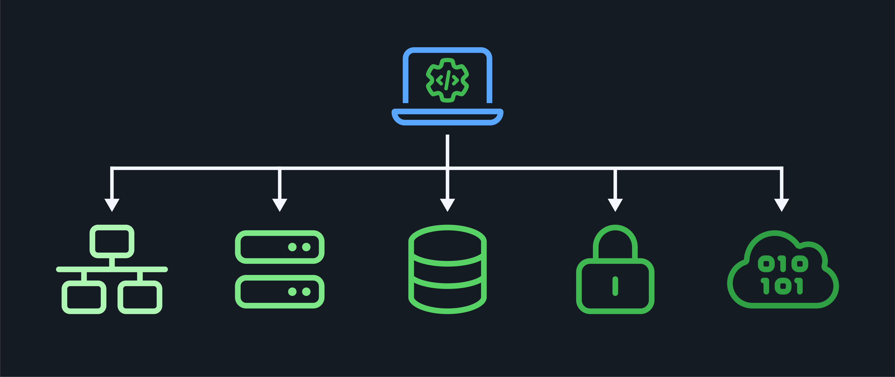

<h1>
  Intro to Infrastructure as Code
  Concepts
</h1>

**Learning objective:** By the end of this lesson, students will be able to define infrastructure as code and explain how it enables the automation and management of IT infrastructure.

## What is infrastructure as code (IaC)?

Infrastructure as code (IaC) allows us to design, create, and manage our IT infrastructure using the power of code and automation.

IaC is the practice of managing and provisioning computing infrastructure and its configuration through machine-readable definition files rather than physical hardware configuration or interactive configuration tools. It's like having a blueprint for your entire IT landscape that you can easily read, share, and modify.

With IaC, we define our desired infrastructure state declaratively using formats like JavaScript Object Notation (JSON) or YAML, specifying everything from servers and networks to security policies. These definition files serve as a single source of truth, ensuring consistency and reducing the risk of manual errors.

By treating infrastructure as code, we unlock the benefits of software development best practices, such as version control, testing, and continuous integration/continuous delivery (CI/CD). This enables collaboration, reproducibility, and the ability to rapidly spin up or tear down environments.

Let's consider a real-world analogy: Imagine you're a chef in a busy restaurant kitchen. Without a standardized recipe and process, each dish would be inconsistent, and the kitchen would be chaotic. IaC is like having a detailed recipe that everyone in the kitchen follows. It ensures that every dish is prepared consistently, ingredients are used efficiently, and the kitchen operates smoothly.

IaC brings that same level of consistency and automation to IT infrastructure management. Instead of manually configuring servers, networks, and security policies, we define them as code. This code serves as a recipe that can be version-controlled, tested, and deployed automatically.

## Why use IaC?

IaC is a game-changer for IT teams, enabling them to manage complex infrastructure with relative ease. It allows us to automate the provisioning and configuration of resources, reducing the time and effort required to set up and maintain our environments.

Here are some of the benefits that using IaC provides:

- **Consistency:** IaC ensures that infrastructure is consistently provisioned and configured across different environments, such as development, staging, and production. This reduces the risk of human error and configuration drift.

- **Scalability:** With IaC, you can quickly scale your infrastructure up or down based on demand. By defining your infrastructure as code, you can quickly spin up new resources or tear them down when they're no longer needed.

- **Collaboration:** IaC enables collaboration among team members. Infrastructure code can be stored in version control systems like Git, allowing multiple people to work on the same codebase, track changes, and review each other's work.

- **Disaster recovery:** IaC allows you to rebuild your infrastructure from code quickly after a disaster or unexpected outage. This reduces downtime and ensures that your infrastructure can be restored to a known state.

Now that we understand the basics of IaC let's explore the tools and components that make it possible.
